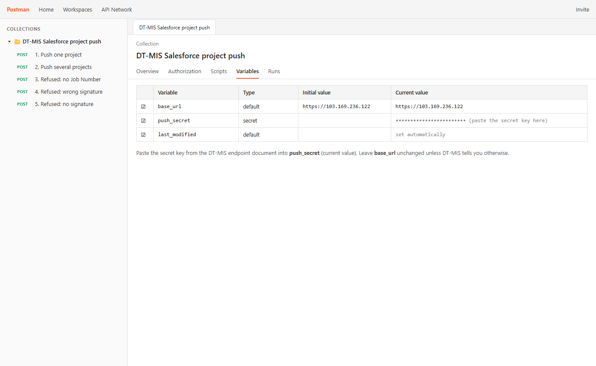
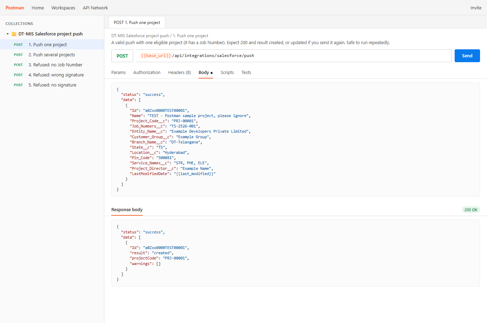
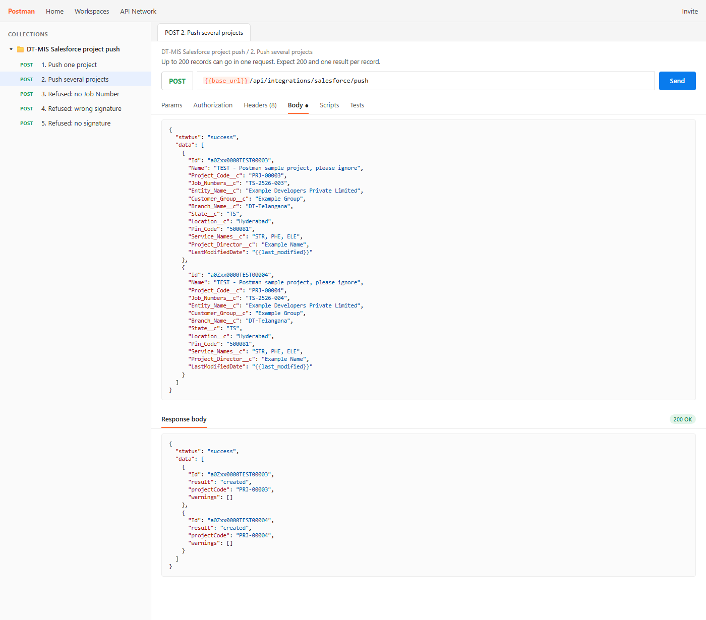
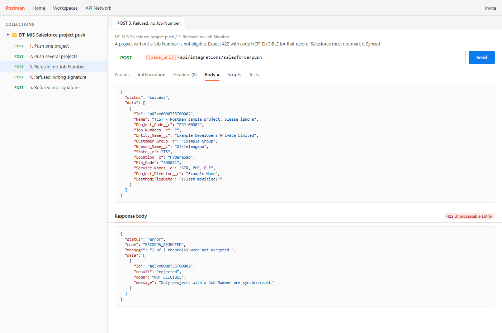
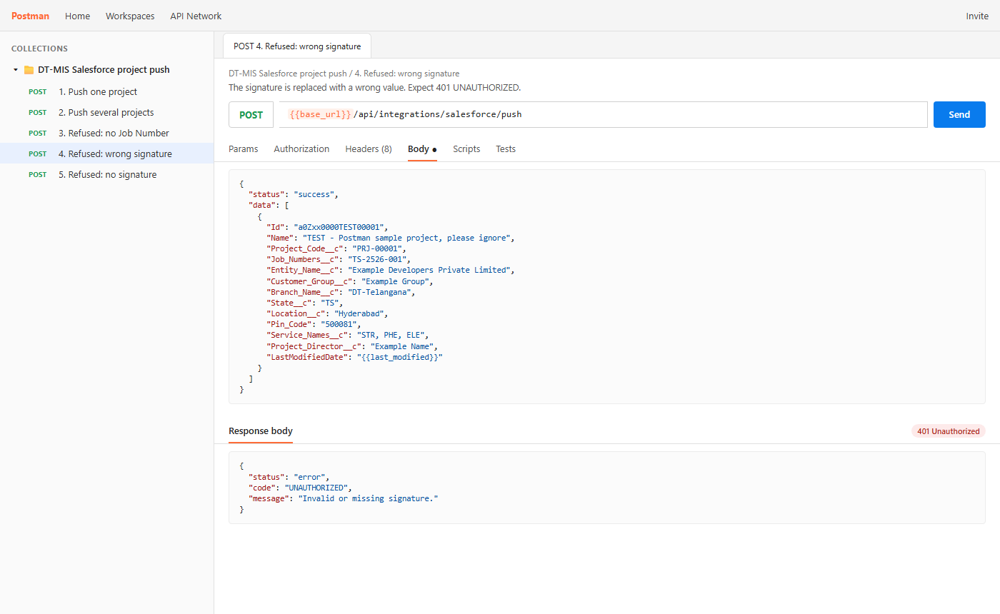
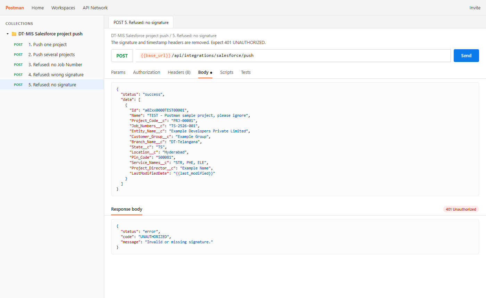
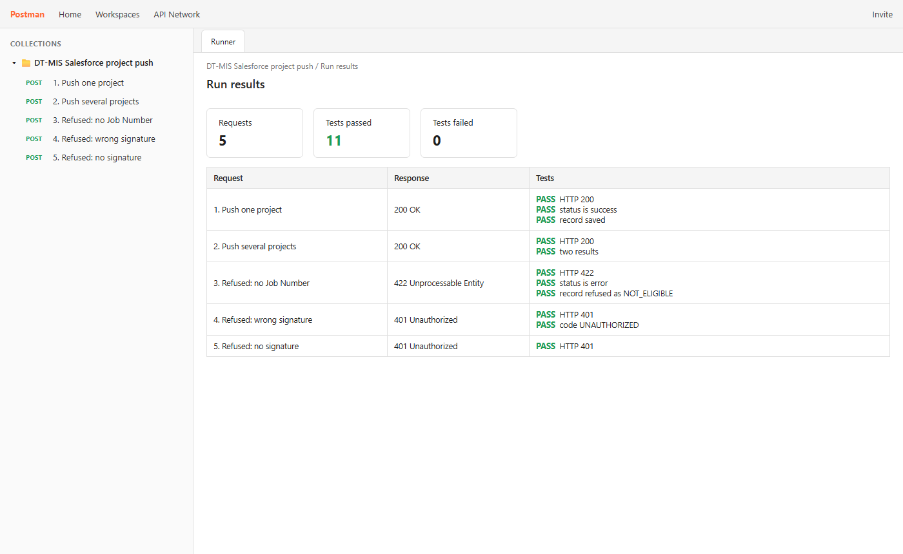

# DT-MIS Salesforce push: Postman collection

Five requests for testing the endpoint that receives projects from Salesforce.
Import `DT-MIS_Salesforce_Push.postman_collection.json` into Postman (Import, then
choose the file).

## Set up

1. Open the collection, then the **Variables** tab.
2. Paste the secret key from the DT-MIS endpoint document into **push_secret**
   (Current value).
3. Leave **base_url** as it is unless DT-MIS tells you otherwise.
4. Run the requests in order, or use **Run collection**. Each request signs itself.

The collection holds no secret. Nothing is stored in the file you import.

## The requests

| Request | Expect |
|---|---|
| 1. Push one project | `200`, result `created` (or `updated` when repeated) |
| 2. Push several projects | `200`, one result per record |
| 3. Refused: no Job Number | `422`, code `NOT_ELIGIBLE` |
| 4. Refused: wrong signature | `401`, code `UNAUTHORIZED` |
| 5. Refused: no signature | `401` |

Each request has tests, so the Run collection summary shows pass or fail for all
11 checks.

## What it looks like

These images show the layout of the collection. The request names, URL, body and
variables are taken from the collection file, so what you see after importing it
will match. Fonts and colours depend on your Postman version.

**Collection variables: paste the secret key into push_secret**

**1. Push one project** (200, created)

**2. Push several projects** (200, one result per record)

**3. Refused: no Job Number** (422, NOT_ELIGIBLE)

**4. Refused: wrong signature** (401, UNAUTHORIZED)

**5. Refused: no signature** (401, UNAUTHORIZED)

**Run collection: all 11 checks pass against a working DT-MIS server**

## How the signing works

A pre-request script on the collection computes
`HMAC-SHA256(push_secret, timestamp + "." + body)` and sets two headers:

- `X-DT-Timestamp`: Unix time in seconds
- `X-DT-Signature`: `sha256=` followed by the hexadecimal result

It signs the body exactly as Postman sends it. The Apex version of the same steps
is in section 3 of the endpoint document. The script also sets `last_modified` to
the current time in Salesforce format, so repeated runs are treated as new versions.

## Test data

Every sample project is named "TEST - Postman sample project, please ignore". Requests
1 and 2 create or update those projects in DT-MIS, where they start as Pending.
Tell DT-MIS before running them against the live server so the test projects can be
removed afterwards.
